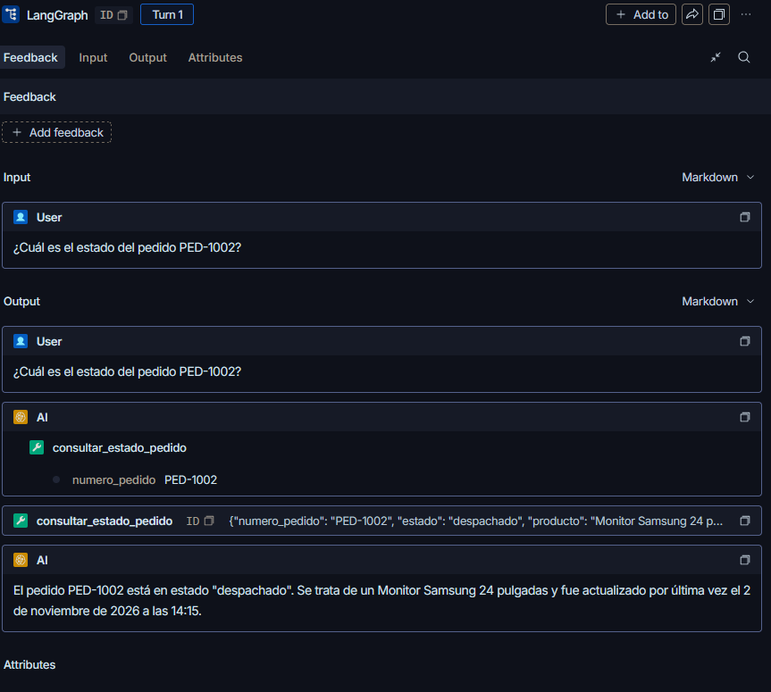

## B. API REST

Se implementó una API REST con FastAPI para exponer el agente TecnoSupply mediante HTTP.

| Endpoint | Método | Función |
|---|---|---|
| `/health` | GET | Verifica la disponibilidad del modelo local, ChromaDB, SQLite de operaciones y SQLite de memoria. |
| `/consultar` | POST | Recibe una consulta y un `thread_id`, ejecuta el agente ReAct y devuelve su respuesta. |
| `/estado/{thread_id}` | GET | Recupera el historial visible persistido de una conversación. |

La API se ejecuta desde la raíz del proyecto con:

```powershell
python -m uvicorn entrega_4.api:app --reload --port 8000
```

La documentación interactiva de FastAPI está disponible en:

```text
http://127.0.0.1:8000/docs
```

### Verificación de salud

La llamada a `GET /health` devolvió:

```json
{
  "estado": "ok",
  "modelo": "qwen3:4b-instruct",
  "memoria_sqlite": true,
  "base_operaciones": true,
  "chroma_local": true
}
```

Este resultado confirma que el modelo local, la memoria SQLite, la base de operaciones y la colección Chroma local estaban disponibles.

### Demostración de memoria vía HTTP

Se realizó una primera consulta mediante `POST /consultar` con el identificador de conversación `api-memoria-001`:

```json
{
  "consulta": "¿Cuál es el estado del pedido PED-1003?",
  "thread_id": "api-memoria-001"
}
```

El sistema respondió que el pedido `PED-1003` se encontraba en tránsito y correspondía a un Mouse Logitech MX Master.

Luego se realizó una segunda consulta utilizando el mismo `thread_id`:

```json
{
  "consulta": "¿Cuál era el producto de ese pedido?",
  "thread_id": "api-memoria-001"
}
```

El agente respondió correctamente que el producto era un Mouse Logitech MX Master, sin requerir nuevamente el número de pedido.

Finalmente, se reinició el servidor Uvicorn y se ejecutó:

```text
GET /estado/api-memoria-001
```

El endpoint devolvió los cuatro mensajes persistidos:

```json
{
  "thread_id": "api-memoria-001",
  "cantidad_mensajes": 4,
  "historial": [
    {
      "rol": "usuario",
      "contenido": "¿Cuál es el estado del pedido PED-1003?"
    },
    {
      "rol": "asistente",
      "contenido": "El pedido PED-1003 se encuentra en tránsito. El producto es Mouse Logitech MX Master. La última actualización fue 2026-11-03 09:40."
    },
    {
      "rol": "usuario",
      "contenido": "¿Cuál era el producto de ese pedido?"
    },
    {
      "rol": "asistente",
      "contenido": "El producto del pedido PED-1003 era un Mouse Logitech MX Master."
    }
  ]
}
```

La respuesta fue inmediata porque `GET /estado` consulta directamente los checkpoints guardados en `memoria_agente.sqlite`; no necesita volver a invocar Ollama ni ChromaDB. La persistencia del historial luego del reinicio demuestra que la memoria depende del `thread_id` y de SQLite, no del proceso activo.

## C. Observabilidad

Se incorporó una capa de observabilidad persistente para registrar la actividad del agente, medir su rendimiento y analizar la ejecución de herramientas.

### Logs estructurados

Cada consulta procesada genera un registro en formato JSON Lines en:

```text
entrega_4/logs/agente.jsonl
```

Cada línea contiene los siguientes campos:

- `timestamp_utc`
- `evento`
- `thread_id`
- `longitud_consulta`
- `latencia_ms`
- `estado`
- `herramientas`
- `bloqueado`
- `detalle_error`

Además, las métricas se conservan en la base SQLite local:

```text
entrega_4/observabilidad.sqlite
```

### Endpoint de métricas

Se implementó el endpoint:

```text
GET /metricas
```

El endpoint calcula cantidad de consultas, errores, bloqueos, latencia promedio, percentil 95 de latencia y frecuencia de uso de cada herramienta.

Durante las pruebas se obtuvo el siguiente resultado:

```json
{
  "consultas": 9,
  "errores": 0,
  "bloqueos": 0,
  "latencia_promedio_ms": 20210.28,
  "latencia_p95_ms": 45074.98,
  "herramientas": {
    "consultar_estado_pedido": 5,
    "registrar_reclamo": 1,
    "buscar_conocimiento": 1
  }
}
```

La herramienta más utilizada fue `consultar_estado_pedido`, con cinco ejecuciones. Las demás herramientas también fueron invocadas durante las pruebas de recuperación RAG y de registro de reclamos.

La latencia promedio fue de 20 210.28 ms y el p95 fue de 45 074.98 ms. Dado que se trata de un conjunto reducido de nueve consultas, el p95 debe interpretarse como evidencia inicial de rendimiento y no como una medición estadística definitiva de producción.

### Trazabilidad con LangSmith

Se habilitó LangSmith con el proyecto:

```text
tecnosupply-agente-entrega4
```

La traza registrada permite visualizar la consulta del usuario, el nodo de IA, la selección de herramientas, los argumentos enviados y la respuesta final.



En la evidencia adjunta, ante la consulta sobre el pedido `PED-1002`, el agente invoca `consultar_estado_pedido` con el argumento `numero_pedido: PED-1002`. La herramienta devuelve el estado `despachado`, el producto asociado y la fecha de actualización. Finalmente, el agente genera la respuesta basada en esos datos.

### Análisis de costos

El sistema utiliza el modelo local `qwen3:4b-instruct` mediante Ollama y los embeddings locales `nomic-embed-text`. Por lo tanto, no existe un costo variable facturado por proveedor de modelo por cada consulta, a diferencia de una API comercial.

LangSmith permite observar la estructura y la latencia de las trazas, pero no registra un costo monetario automático para las inferencias ejecutadas localmente. El costo operativo queda asociado al uso de CPU, RAM, energía y tiempo de ejecución del equipo local. Esta elección eliminó las restricciones de cuota que afectaban las pruebas con Gemini, a cambio de una latencia mayor y de la necesidad de aplicar guardrails de fundamentación sobre las respuestas.